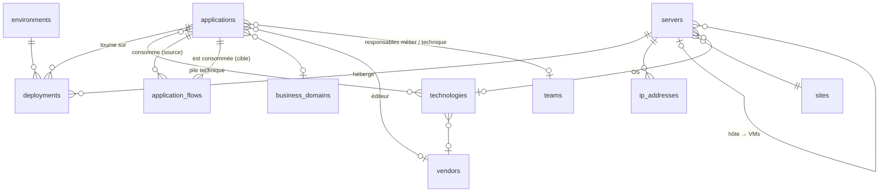

<p align="center"></p>

# MeriMap

Cartographie des serveurs et des applications du SI. Successeur de **Kerberos**.

Stack : **Laravel 13** (PHP 8.3+) · **Inertia 3** · **Vue 3 + TypeScript** · **Tailwind 4** · authentification Fortify (2FA, passkeys).

> État : **étapes 1 à 3 terminées** — modèle de données, reprise Kerberos, interface MeriMap (thème clair/sombre),
> Catalogue CMDB, topologie interactive et simulation de panne.
> Prochaine étape : gouvernance (obsolescence, flux non conformes, audits).

## Écrans disponibles

| Écran                | Contenu                                                                                                                                                                             |
| -------------------- | ----------------------------------------------------------------------------------------------------------------------------------------------------------------------------------- |
| **Tableau de bord**  | Indicateurs, points d'attention (OS en fin de vie, flux en clair, applications sans responsable…), applications vitales                                                             |
| **Applications**     | Liste filtrable et triable, export CSV, fiche (hébergement, dépendances amont/aval, gouvernance, SLA/RTO/RPO, pile technique), création/modification                                |
| **Serveurs**         | Liste filtrable (recherche par nom, FQDN ou IP), export CSV, fiche (applications hébergées, VMs, matériel), création/modification                                                   |
| **Topologie & flux** | Graphe interactif applications → serveurs → hyperviseurs, filtres (environnement, domaine), vue centrée sur une application, inspecteur, flux en clair signalés                     |
| **Analyse d'impact** | Panne simulée de serveurs et/ou d'applications : score, applications indisponibles ou dégradées, utilisateurs touchés, arbre de cascade, graphe de propagation, équipes à mobiliser |
| **Référentiels**     | Sites, environnements, équipes, éditeurs, domaines métier, technologies et dates de fin de support                                                                                  |

Les filtres sont dans l'URL : une vue filtrée se partage par simple copier-coller du lien.
Les exports CSV (séparateur `;`, UTF-8 avec BOM) s'ouvrent directement dans Excel et reprennent les filtres actifs.

---

## Installation

> **Mise en production** :
>
> - pilote hébergé sur **Laravel Cloud** : [docs/LARAVEL-CLOUD.md](docs/LARAVEL-CLOUD.md)
> - serveur interne **Windows** (WampServer) : [docs/INSTALLATION-WINDOWS.md](docs/INSTALLATION-WINDOWS.md)
> - serveur interne **Linux** (Apache/Nginx) : [docs/INSTALLATION.md](docs/INSTALLATION.md)
>
> MeriMap est testé sur MySQL/MariaDB, PostgreSQL et SQLite.

Poste de développement :

```bash
composer install
cp .env.example .env
php artisan key:generate
touch database/database.sqlite        # ou configurer MySQL/MariaDB dans .env
php artisan migrate --seed            # référentiels + données de démo (hors production)
npm install
npm run build                         # ou : composer dev  (serveur + Vite en parallèle)
```

Comptes de démo (local uniquement, mot de passe `password`). En production, créer les comptes avec
`php artisan merimap:user email@domaine --role=admin|editor|reader` (l'inscription libre est désactivée,
voir `MERIMAP_REGISTRATION`).

`admin@merimap.test` (Administrateur), `editeur@merimap.test` (Contributeur), `lecteur@merimap.test` (Lecteur).

Tests : `php artisan test` (après `npm run build`, certaines pages Inertia en ont besoin) · Style PHP : `vendor/bin/pint`

## Reprise des données Kerberos

1. Renseigner l'accès à l'ancienne base `carto` dans `.env` (`KERBEROS_DB_*`).
2. Lancer une simulation : `php artisan kerberos:import --dry-run`
3. Lire le rapport (avertissements : doublons, IP invalides, mots de passe en clair…), puis :
   `php artisan kerberos:import`

Options : `--environment=PROD` (environnement attribué), `--email-domain=kerberos.invalid`.

Ce que fait l'import :

| Kerberos                         | MeriMap                                                                                |
| -------------------------------- | -------------------------------------------------------------------------------------- |
| `serveur`                        | `servers` + `ip_addresses` (plusieurs IP séparées), site, OS (catalogue), criticité    |
| commentaire « Hyperviseur: xxx » | vrai lien VM → hôte (`host_id`), hôte créé si absent                                   |
| `application`                    | `applications` + `deployments` (app ↔ serveur) + technologies                          |
| `dependance` (AD, SSO…)          | service technique partagé + **flux** applicatif                                        |
| `relation` sans cible            | conservée dans la description                                                          |
| `users`                          | comptes avec rôle : super_admin → Administrateur, admin → Contributeur, user → Lecteur |

- **Idempotent** : chaque élément garde son `kerberos_id`, on peut relancer sans doublons.
- Les hash bcrypt de Kerberos sont **réutilisés** (les utilisateurs gardent leur mot de passe).
  Les mots de passe stockés **en clair** ne sont jamais repris : un mot de passe aléatoire est posé
  et l'avertissement indique les comptes à réinitialiser.
- Kerberos n'a pas d'e-mail : les comptes reçoivent `identifiant@kerberos.invalid`, à corriger ensuite.

## Modèle de données



Différences clés avec Kerberos :

- **Relations N-N** : une application tourne sur plusieurs serveurs (par rôle : web, base, batch…)
  et dépend de plusieurs applications via des **flux orientés** (protocole, port, chiffré ou non, critique ou non).
- **Hiérarchie physique** : une VM connaît son hyperviseur.
- **Cycle de vie** : chaque technologie (OS, moteur BDD, langage) porte ses dates de fin de support / fin de vie.
  Les dates du `ReferenceSeeder` sont indicatives : à faire valider avant un audit.
- **Gouvernance** : criticité (Tier 1 à 4), classification des données, données personnelles (RGPD), SLA, RTO/RPO, équipes responsables.
- Codes CMDB automatiques (`APP-0001`…), suppression logique (rien n'est perdu), énumérations typées (`app/Enums`).

## Analyse d'impact

`App\Services\Impact\ImpactAnalyzer` simule la panne d'un ou plusieurs serveurs :

1. la panne d'un hôte physique fait tomber ses VMs (récursivement) ;
2. pour chaque rôle de déploiement, tous les serveurs en panne ⇒ application **indisponible**,
   une partie seulement ⇒ **dégradée** (la redondance tient) ;
3. la panne se propage aux applications consommatrices : indisponible via un flux critique,
   dégradée via un flux non critique. Les cycles de dépendances sont gérés.

On peut aussi simuler la panne d'une **application** (« épicentre ») : `simulateApplicationFailure()`,
ou combiner serveurs et applications : `simulate($servers, $applications)`.

**Score d'impact** (0–100) : somme des applications touchées pondérées par leur criticité
(Tier 1 = 25, Tier 2 = 12, Tier 3 = 5, Tier 4 = 2 ; moitié si seulement dégradée), plafonnée à 100.
C'est un indicateur de comparaison entre scénarios, pas une mesure absolue : ajustez les poids
dans `ImpactReport::score()` selon votre politique de risque.

L'écran est accessible par URL, ce qui permet de partager un scénario :
`/impact?servers[]=1&applications[]=5`.

## Droits

| Rôle           | Lecture | Modifier la CMDB (`edit-cmdb`) | Gérer les utilisateurs (`manage-users`) |
| -------------- | ------- | ------------------------------ | --------------------------------------- |
| Lecteur        | ✓       |                                |                                         |
| Contributeur   | ✓       | ✓                              |                                         |
| Administrateur | ✓       | ✓                              | ✓                                       |

Les nouveaux comptes sont **Lecteur** par défaut.

## Architecture frontend

- Pages Inertia : `resources/js/pages/{servers,applications,references}/` et `Dashboard.vue`
- Composants CMDB réutilisables : `resources/js/components/cmdb/` (badges d'état, panneaux, filtres, pagination, dialogues)
- Routes typées générées par **Wayfinder** (`import servers from '@/routes/servers'` → `servers.show(id)`) :
  plus d'URL écrites à la main, une route renommée côté Laravel casse la compilation TypeScript au lieu de casser en production.
- Thème : variables CSS dans `resources/css/app.css`, aux couleurs du logo (clair : accent bleu marine, sombre : accent orange),
  polices Inter / Geist / JetBrains Mono auto-hébergées.
- Marque : emblème vectoriel `resources/js/components/BrandMark.vue` (version complète et compacte),
  logotype `BrandWordmark.vue`, favicons dans `public/` et logo d'origine dans `public/brand/`.

Vérifications frontend : `npm run types:check` (TypeScript) · `npm run check` (lint + format).

## Arborescence utile

```
app/Enums/                 énumérations métier (libellés FR, options pour les formulaires)
app/Models/                Server, Application, Deployment, ApplicationFlow, Technology…
app/Services/Impact/       moteur d'analyse d'impact
app/Services/Kerberos/     reprise des données Kerberos
app/Services/Topology/     construction du graphe (nœuds, flux, déploiements, hébergement)
resources/js/components/topology/  canvas Vue Flow, nœuds personnalisés, disposition automatique (dagre)
app/Console/Commands/      kerberos:import
app/Http/Controllers/Cmdb/ contrôleurs des écrans (serveurs, applications, flux, déploiements, référentiels)
app/Http/Requests/Cmdb/    validations (messages FR dans lang/fr/validation.php)
app/Http/Resources/        mise en forme des données envoyées aux pages
app/Support/               listes d'options, export CSV, définition des référentiels
database/migrations/       2026_11_06_* = schéma MeriMap
database/seeders/          ReferenceSeeder (prod) · DemoSeeder (local)
tests/Feature/Cmdb/        tests du modèle, de l'import, de l'analyse d'impact et des écrans
```

## Suite prévue

1. ~~Socle + modèle de données + import Kerberos~~
2. ~~Interface au design MeriMap (thème clair/sombre) et Catalogue CMDB~~
3. ~~Topologie & flux (Vue Flow + dagre) et écran d'analyse d'impact~~
4. **Gouvernance** : matrice d'obsolescence, flux non conformes, rapport d'audit exportable
